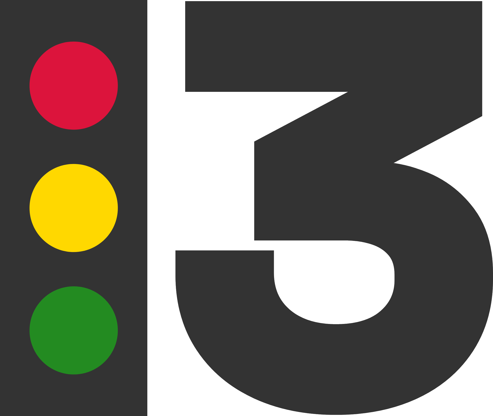
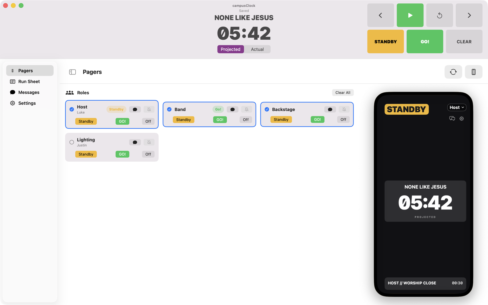
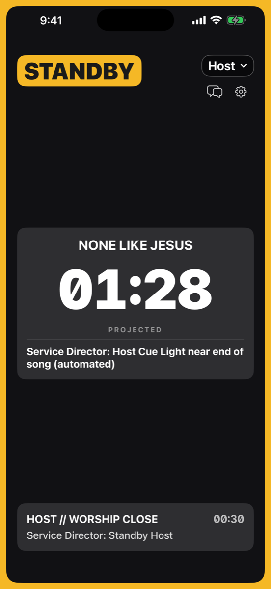
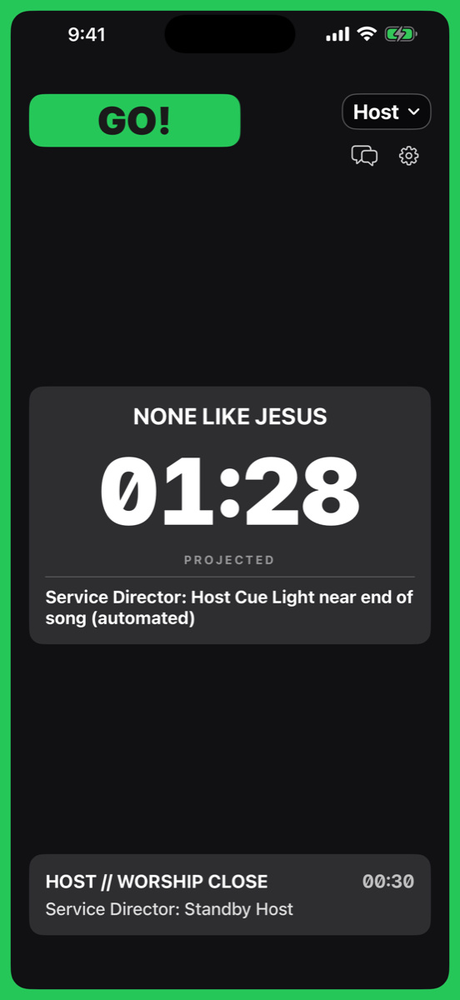
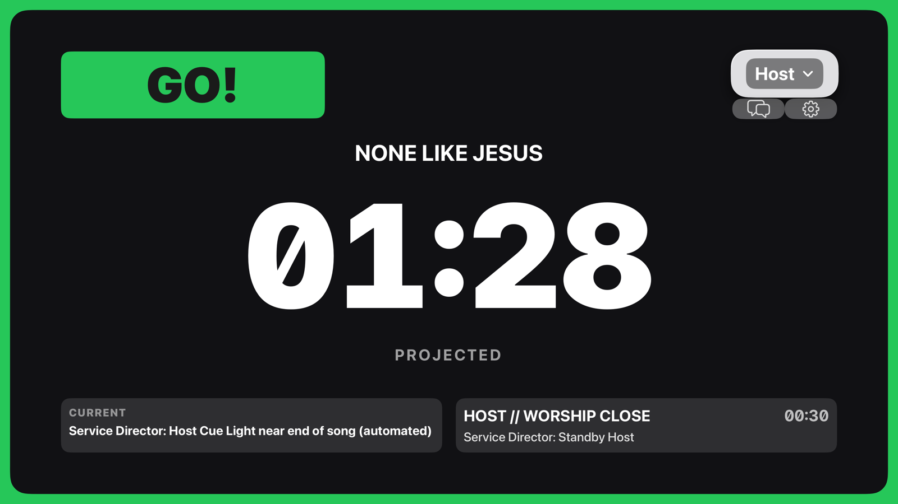
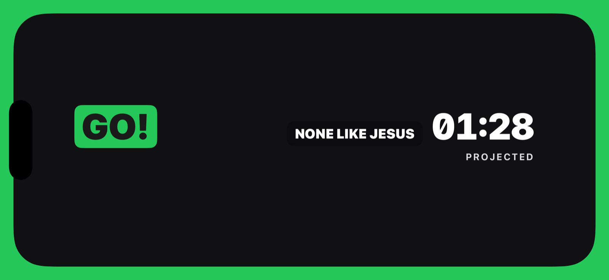
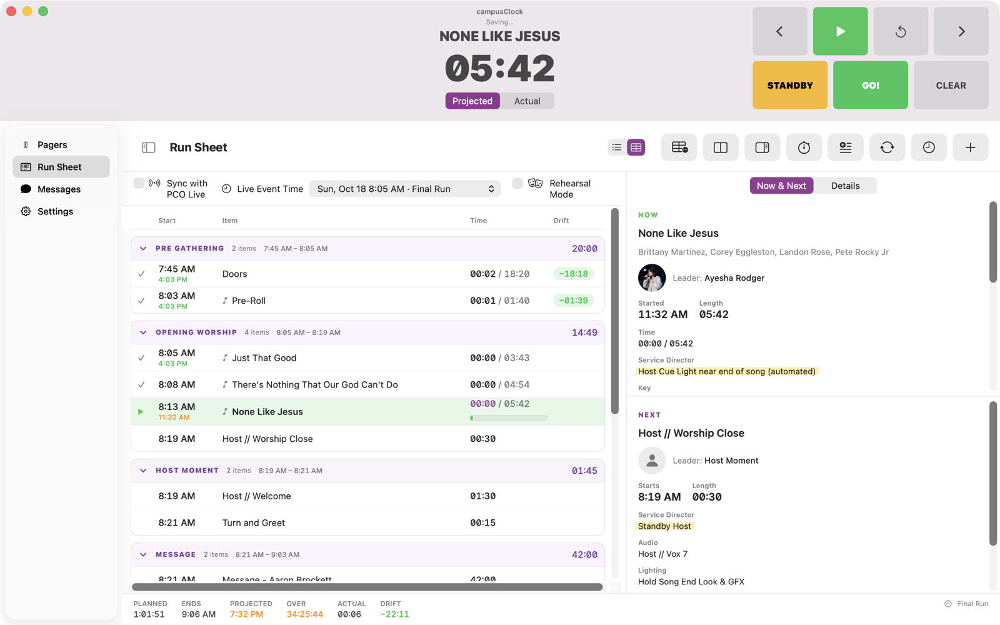
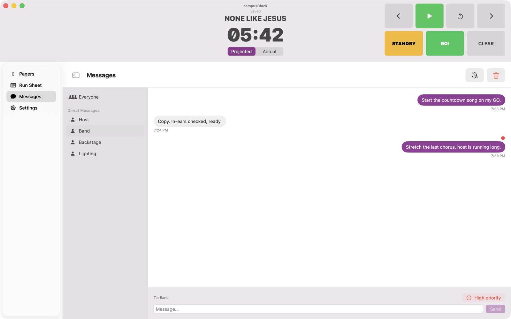

<p align="center">
  <picture>
    <source media="(prefers-color-scheme: dark)" srcset="stoplight-13-mark-dark.png">
    
  </picture>
</p>

<h1 align="center">13 Years</h1>

<p align="center"><b>Cue lights for whoever’s on the floor. No headset needed.</b></p>

<p align="center">The producer calls it. Every role sees STANDBY, GO, a synced countdown and their own notes, on the phone already in their pocket.</p>

<p align="center">
  <a href="https://testflight.apple.com/join/sbn2ecQQ"></a>
  <a href="https://github.com/TristonYoder/13years/releases/latest"></a>
  <a href="https://13years.app"></a>
</p>

<p align="center"><sub>No account. No analytics. Nothing sent to us. Open source under AGPL-3.0.</sub></p>

<p align="center">
  
  
</p>

## From the booth

The Producer runs on a Mac or iPad, or headless on a server. It holds the plan, the clock and every role, and it shows you exactly what each pager is showing.

- **Standby. Go. Clear.** Big buttons for the call. Arrows step through the plan; play starts the item’s clock.
- **Every role, one tap.** Cue the host, the band, backstage or lighting together or one at a time, and see who’s on standby.
- **See their screen.** A live preview of any role’s pager, so you know what they’re looking at.

## Everyone gets a pager

Pick a role (host, tech, band, anything) and the pager shows only what that role needs, readable from across the stage: its cue state, the active item with its countdown, what’s next, notes, and messages. Portrait, landscape, or a lower third over your own screen.

<table>
  <tr>
    <td align="center" valign="bottom"></td>
    <td align="center" valign="bottom"></td>
    <td align="center" valign="bottom"></td>
  </tr>
  <tr>
    <td align="center"><b>Phone or iPad</b><br><sub>STANDBY and GO in big colour</sub></td>
    <td align="center"><b>Apple TV or Mac</b><br><sub>for the green room or a confidence monitor</sub></td>
    <td align="center"><b>Lower third</b><br><sub>cue and countdown, out of the way</sub></td>
  </tr>
</table>

Crew who would rather not hold a phone on stage can use a small dedicated pager built on an ESP32 board (see [`Hardware/esp32`](Hardware/esp32/README.md)).

## The plan you already built



The producer’s run sheet pulls everything it can from a Planning Center plan: item descriptions, songs with key, BPM, meter and sequence, media, and per-time exclusions. It has a list and (on Mac) a customizable table view, projected start times and totals, and a plan panel with notes, times and team (roles can link to a team position). It records actual lengths per event, lets you skip items or rehearse without logging, and can save actual lengths back to the plan. Each role chooses which item details its pagers show. Attachments and lyric or chord charts open on demand from the producer without being sent to pagers. Planning Center is optional; you can build a plan by hand too.

## Say it without the headset



Message one role or everyone. Pagers show it on screen, the reply comes back to the booth, and a high-priority message doesn’t wait for someone to look down.

## Set up before doors

🔴 **Run the Producer** on a Mac or iPad, or a hosted headless Producer your team keeps on.<br>
🟡 **Open a Pager** on an iPhone, iPad, Apple TV, Mac or ESP32 on the same network. It finds the Producer, or type `host:13380`.<br>
🟢 **Pick a role.** Host, tech, band, anything. STANDBY, GO, the countdown and your notes, just for you.

**Runs on** iPhone · iPad · Apple TV · Mac · ESP32 <sub>(pager)</sub> · Linux <sub>(hosted Producer)</sub>

## Nothing to sign up for

No account. No analytics. No tracking. No ads. No developer server. Cue and message data stays between your devices and your Producer; see the [privacy policy](https://13years.app/privacy/).

## Doors in eight. Get it on the floor.

The Pager is heading to the App Store. Until then, the public beta is open on [TestFlight](https://testflight.apple.com/join/sbn2ecQQ). The Producer for Mac and the Mac Pager are disk images on [GitHub Releases](https://github.com/TristonYoder/13years/releases/latest).

---

## Components

| Path | What it is |
| --- | --- |
| `Sources/ProducerMac`, `Sources/ProducerIOS` | Producer apps (macOS, iPadOS/iOS). Run the plan, fire cues, serve the control API. |
| `Sources/PagerIOS`, `Sources/PagerTV`, `Sources/PagerMac`, `Sources/ProducerWatch` | Pager apps (iOS/iPadOS, tvOS, macOS, watchOS). |
| `Sources/Shared` | Models, services and views shared across every app target. |
| `Hardware/esp32` | Firmware for a hardware pager on an ESP32 "Cheap Yellow Display" board. See its [README](Hardware/esp32/README.md). |
| `Server` | Small WebSocket relay for pagers that are not on the producer's LAN. See its [README](Server/README.md) and [PROTOCOL](Server/PROTOCOL.md). |
| `CONTROL-API.md` | HTTP and WebSocket control API (Stream Deck, Companion, QLab, scripts). |

On a shared LAN, devices find each other over Bonjour (`_13years._tcp`) and talk point-to-point over TCP.

## Building

The Xcode project is generated from `project.yml` and is not checked in.

```bash
brew install xcodegen
xcodegen generate
open ThirteenYears.xcodeproj
```

Signing and the Planning Center OAuth client ID are not in the repository. `Config/Base.xcconfig` defines them empty and includes an optional, git-ignored `Config/Local.xcconfig`:

```
DEVELOPMENT_TEAM = YOUR_TEAM_ID
PCO_OAUTH_CLIENT_ID = your-planning-center-oauth-client-id
```

Register your own OAuth application at Planning Center (redirect URI `thirteenyears://oauth/callback`, scope `services`). Without a client ID the app builds, but PCO sign-in reports that none is configured. Bundle identifiers use the `app.13years` prefix in `project.yml`; change them to build under your own account.

CI (`.github/workflows/apple-build.yml`) writes `Config/Local.xcconfig` from two repository secrets:

```bash
gh secret set APPLE_TEAM_ID
gh secret set PCO_OAUTH_CLIENT_ID
```

```bash
cd Server && npm ci && npm test
```

Firmware builds with PlatformIO; see `Hardware/esp32/README.md`.

## Contributing

Pull requests need a signed [CLA](CLA.md); see [CONTRIBUTING.md](CONTRIBUTING.md).

## License

Copyright (C) 2026 Triston Yoder. Licensed under the GNU Affero General Public License v3.0 only (`AGPL-3.0-only`); see [LICENSE](LICENSE). Bundled third-party material and its licenses are listed in [NOTICE.md](NOTICE.md).
